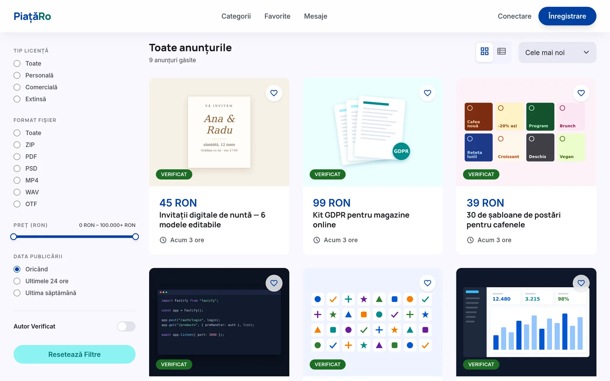
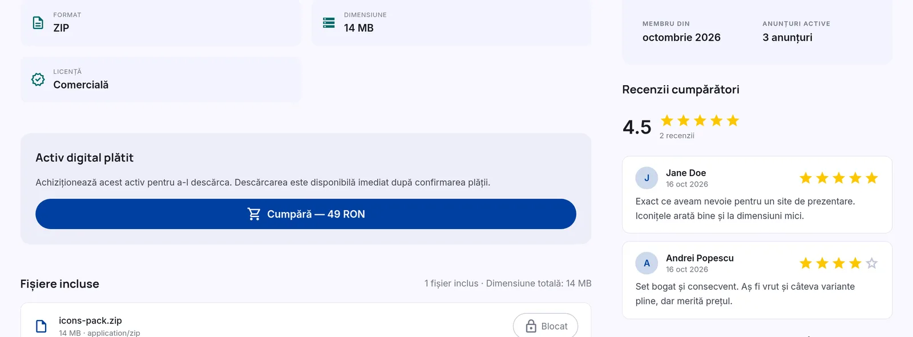
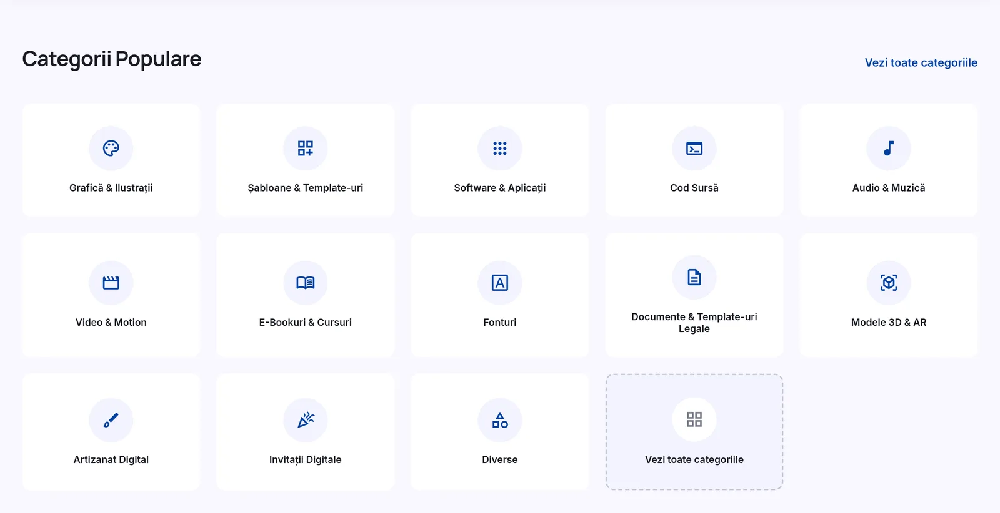
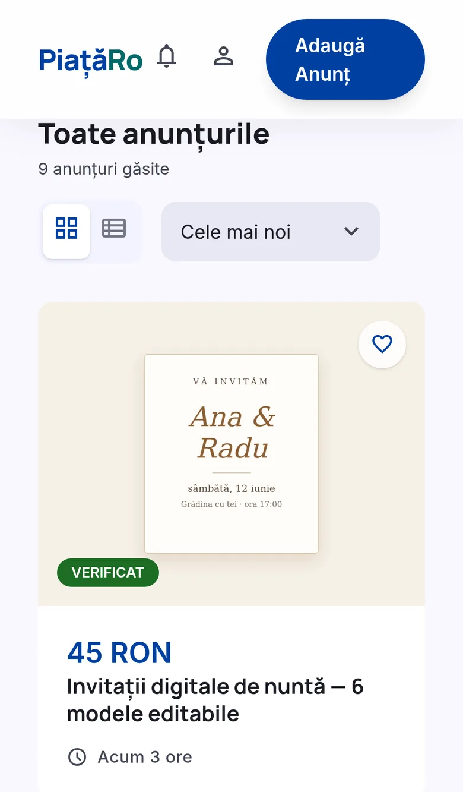
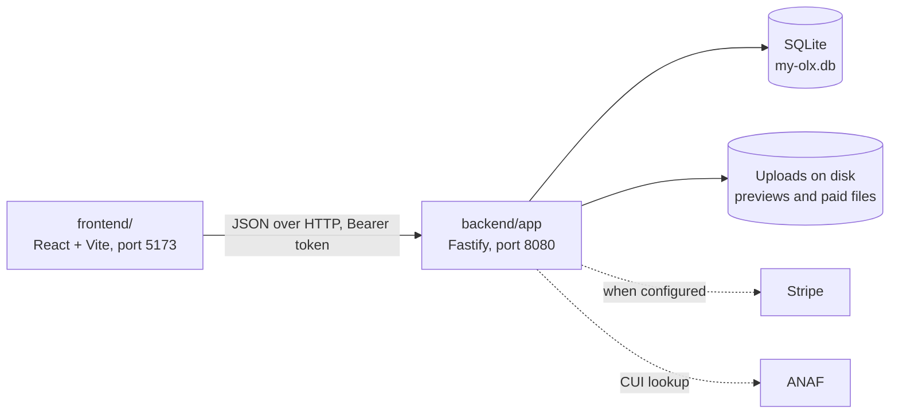

# PiațăRo

A Romanian marketplace for digital files. Creators sell templates, graphics, fonts, source code, audio, e-books and other downloads, priced in lei, and buyers pay and download them. Nothing physical, so no shipping. In the code the project is called `my-olx`.

<p align="center">
  
</p>

**Status:** Prototype, paused since 2026-05-29 and not deployed. Browsing, listing pages, and buying and reviewing through the built-in fake payment provider work locally. In the current build the "Adaugă anunț" page never loads for a new listing and the seller's "Anunțurile mele" page fails to load. Emails only go to the server log, the Stripe path is untested, and sellers can't be paid out yet, so it can't take real money.

## What it does

- Lists digital files in 13 categories, from graphics, templates and fonts to legal documents, 3D models and digital invitations. Each listing has a licence (personal, commercial or extended), a price in lei or none, preview images and the files themselves.
- Lets buyers filter by licence, file format, price and date, and search without diacritics: `sablon` finds `șablon`.
- Keeps a paid listing's files locked until the order is paid, then lets the buyer download them. Only buyers who paid can leave a review.
- Sells bundles: one listing that grants the files of several others, such as a wedding pack of invitation, menu and place cards.
- Generates invoices as PDF and as e-Factura XML (UBL 2.1), with company details filled in from a CUI through ANAF.
- Expires listings after 30 days, with reminder emails before and on the day, and allows 5 new listings a week per account.

The market research in the corpus found no Romanian platform that combines Romanian-language listings, prices in lei and e-Factura invoices; the closest local shops sell only legal documents. PiațăRo leaves out physical goods, shipping and locations on purpose.

## Screenshots



A paid listing: the file stays locked (Blocat) until the order is paid, and only buyers who paid can review.

| The categories on the home page | On a phone |
|---|---|
|  |  |

The screens show the demo accounts the migrations create and listings with invented content and generated preview pictures. How each image was made: [docs/images/shots.md](docs/images/shots.md).

## How it works

Two separate npm projects. `backend/` is a Fastify API in an npm workspace: `core/` is the engine (SQLite through Kysely with migrations that run at start-up, JWT and Argon2 sign-in, files on disk, email) and `app/` is the marketplace (routes for listings, files, orders, reviews, bundles, invoices and messages). `frontend/` is a React app on Vite with TanStack Router, React Query, Tailwind CSS v4 and react-i18next, in Romanian by default. Payments go through a provider interface: a fake provider in development, and Stripe when its two keys are set.



More in [docs/architecture.md](docs/architecture.md).

## Run it locally

Tested on Node 24. Run the API and the web app in two terminals. The API needs a `JWT_SECRET`, and nothing reads `backend/.env`, so pass it on the command line.

```bash
cd backend && npm install && npm run build      # dev imports core from its build
JWT_SECRET=$(openssl rand -hex 32) npm run dev  # API on http://localhost:8080
```

```bash
cd frontend && npm install
npm run dev                                     # web app on http://localhost:5173
```

Then open <http://localhost:5173/>. The migrations put demo accounts and listings into every new database, so remove them before any deploy. Env vars, the demo data, tests and common problems: [docs/getting-started.md](docs/getting-started.md).

## Project layout

| Path | What lives there |
|---|---|
| `backend/core/` | `@my-olx/core`: database, auth, storage, email, config, the Fastify factory |
| `backend/app/` | `@my-olx/app`: the marketplace routes and repositories |
| `backend/migrations/` | SQL migrations, applied at start-up, including the demo data |
| `frontend/` | The React app |
| `design/` | The Carpathian Clear design system and the HTML mock-ups |
| `corpus/` | Project wiki: features, market research, business rules, log |
| `docs/` | Setup, architecture and the images here |

## Docs

- [docs/](docs/README.md): setup, architecture, and the images used here
- [corpus/](corpus/pages/index.md): the project wiki, with the features, market research and business rules
- [design/](design/README.md): the Carpathian Clear design system and the mock-ups the UI was built from

## License

[Apache License 2.0](LICENSE).
