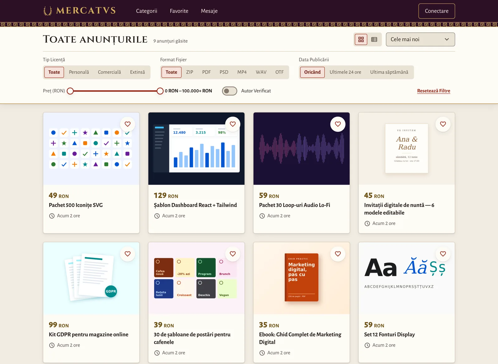
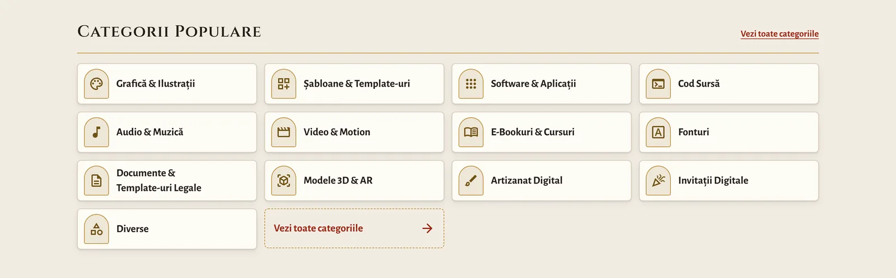
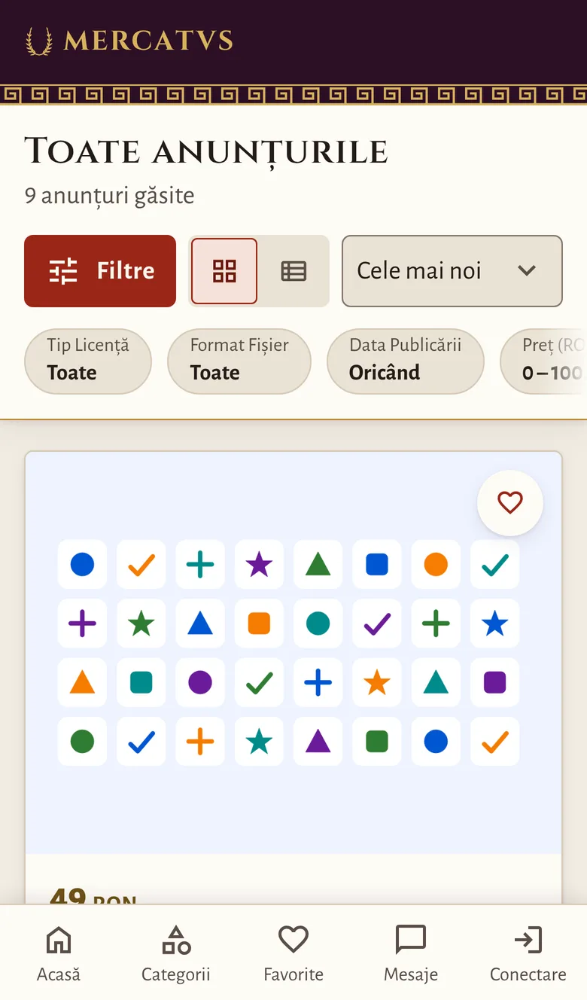
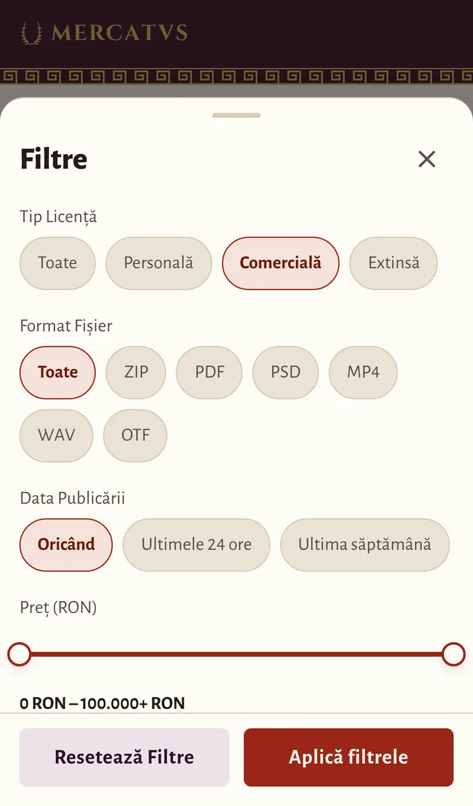
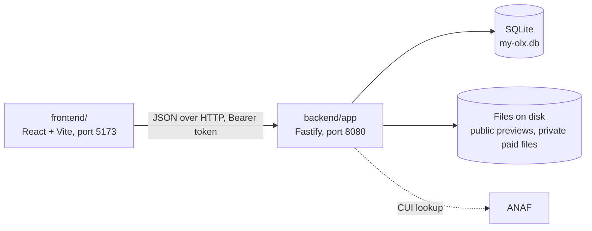

# PiațăRo

A Romanian marketplace for digital files. Creators sell templates, graphics, fonts, source code, audio, e-books and other downloads, priced in lei, and buyers pay and download them. Nothing physical, so no shipping. In the code the project is called `my-olx`.

<p align="center">
  
</p>

**Status:** Being turned into a deployed demo, decided on 2026-11-03. Payments are simulated, only the owner signs in, and visitors browse read-only. Browsing, listing pages, creating listings, and buying and reviewing through the built-in fake payment provider work locally. The UI was redesigned on 2026-11-13. The deploy is written but, per the project wiki's status of 2026-11-13, has not run yet, so there is no live link. Emails only go to the server log. It takes no real money.

## What it does

- Lists digital files in 13 categories, from graphics, templates and fonts to legal documents, 3D models and digital invitations. Each listing has a licence (personal, commercial or extended), a price in lei or none, preview images and the files themselves.
- Lets buyers filter by licence, file format, date, price and verified authors, and search without diacritics: `sablon` finds `șablon`.
- Keeps a paid listing's files locked until the order is paid, then lets the buyer download them. Only buyers who paid can leave a review.
- Sells bundles: one listing that grants the files of several others, such as a wedding pack of invitation, menu and place cards.
- Generates invoices as PDF and as e-Factura XML (UBL 2.1), with company details filled in from a CUI through ANAF.
- Expires listings after 30 days, with reminder emails before and on the day, and allows 5 new listings a week per account.

The market research in the corpus found no Romanian platform that combines Romanian-language listings, prices in lei and e-Factura invoices; the closest local shops sell only legal documents. PiațăRo leaves out physical goods, shipping and locations on purpose.

## Screenshots


A paid listing. The file stays locked (Blocat) until the order is paid, and only buyers who paid can review.



The home page's categories.

| On a phone | The filters on a phone |
|---|---|
|  |  |

On a phone the filters move into a sheet, and the picks apply together from **Aplică filtrele**.

The screens show the nine sample listings `npm run seed:samples` adds, the same ones the demo shows, browsed signed out. Their content and preview pictures are invented. How each image was made: [docs/images/shots.md](docs/images/shots.md).

## How it works

Two separate npm projects. `backend/` is a Fastify API in one package, `@my-olx/app`. Its `features/` folder holds the marketplace routes (listings, files, orders, reviews, bundles, invoices, messages, payouts), and `db/`, `lib/` and `plugins/` hold the engine (SQLite through Kysely with migrations that run at start-up, JWT and Argon2 sign-in, files on disk, email). `frontend/` is a React app on Vite with TanStack Router, React Query, Base UI, Tailwind CSS v4 and react-i18next, in Romanian by default. Payments go through a fake provider; no money moves.



More in [docs/architecture.md](docs/architecture.md).

## Run it locally

Needs Node 24 or later (the root `package.json`). Run the API and the web app in two terminals.

```bash
cd backend && npm ci
npm run seed:samples                            # the nine sample listings the demo shows
JWT_SECRET=$(openssl rand -hex 32) npm run dev  # API on http://localhost:8080
```

```bash
cd frontend && npm ci
npm run dev                                     # web app on http://localhost:5173
```

Then open <http://localhost:5173/>. Instead of passing `JWT_SECRET` each time, you can copy `backend/.env.example` to `backend/.env` and set it there. There is no sign-up. `npm run create-owner` in `backend/` makes the one account that signs in, from `OWNER_EMAIL`, `OWNER_PASSWORD` and `OWNER_NAME`. Env vars, the accounts, tests and common problems: [docs/getting-started.md](docs/getting-started.md).

## Project layout

| Path | What lives there |
|---|---|
| `backend/app/` | `@my-olx/app`, the server: plugins, lib, db and the marketplace features |
| `backend/migrations/` | SQL migrations, applied at start-up |
| `backend/seed/` | The local demo data (`npm run seed:dev`, development only) and the sample listings' previews (`npm run seed:samples`) |
| `frontend/` | The React app, and its Playwright specs in `frontend/e2e/` |
| `infrastructure/` | The API's container: `Dockerfile` and `docker-compose.yml` ([docs/deploy.md](docs/deploy.md)) |
| `design/` | The Carpathian Clear design system and the HTML mock-ups |
| `corpus/` | Project wiki: features, market research, business rules, log |
| `docs/` | Setup, the deploy, architecture and the images here |
| `package.json`, `vendor/`, `scripts/` | The house-style tools and checks; `npm run check` at the root runs them over both projects |

## Docs

- [docs/](docs/README.md): setup, the deploy, architecture, and the images used here
- [corpus/](corpus/index.md): the project wiki, with the features, market research and business rules
- [design/](design/README.md): the Carpathian Clear design system and the mock-ups the UI was first built from; the colours and type the redesign shipped are in [corpus/wiki/carpathian-clear.md](corpus/wiki/carpathian-clear.md)

## License

[Apache License 2.0](LICENSE).
