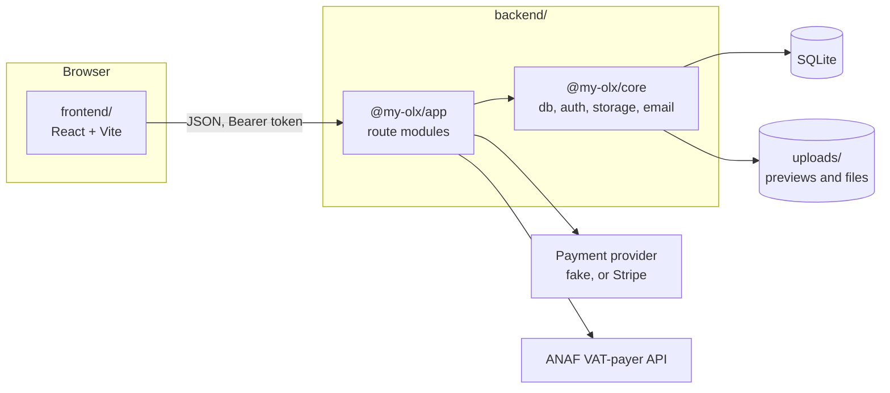

# Architecture

PiațăRo is two npm projects. `backend/` is an npm workspace with two packages.
`@my-olx/core` is the engine: a Kysely instance over SQLite (better-sqlite3)
with a small migrator, JWT and Argon2 for sign-in, disk storage for uploads,
the email service and a Fastify factory with CORS, compression, multipart and
static files. `@my-olx/app` is the marketplace on top: one module per area
(auth, users, listings, images, assets, orders, reviews, bundles, invoices,
favorites, messaging, the ANAF lookup), each registering its own routes. At
start-up it applies every new SQL file in `backend/migrations/`. `frontend/`
is a React app on Vite: TanStack Router for routes, React Query and Axios for
data (the Axios client adds the Bearer token), React Hook Form and Zod for
forms, Tailwind CSS v4 with the Carpathian Clear tokens, and react-i18next
with Romanian as the default language.

## Buying a file

1. A seller creates a listing, uploads one or more files and optional preview
   images, and publishes it. Publishing needs a verified email, at least one
   file and a free slot in the week's limit of 5.
2. A buyer opens the listing. `GET /listings/:id/assets` lists the files by
   name and size, without their storage paths.
3. For a paid listing the buyer starts an order with `POST /orders`. The
   payment provider returns a checkout address; in development the fake
   provider's `POST /orders/:id/mark-paid` stands in for it.
4. Once the order is paid, `GET /listings/:id/assets/:asset_id/download`
   streams the file to that buyer. A free listing skips the order.
5. The buyer can now review the listing with `POST /listings/:id/reviews`;
   the route checks for a paid order first.

Bundles reuse the same path: a bundle is a listing whose order unlocks the
files of every listing it groups.

## Read more

- [corpus/pages/tech/stack.md](../corpus/pages/tech/stack.md): the stack in
  detail
- [corpus/pages/features/](../corpus/pages/features/): one page per feature,
  including [digital-asset-commerce](../corpus/pages/features/digital-asset-commerce.md),
  [invoicing](../corpus/pages/features/invoicing.md) and
  [bundles](../corpus/pages/features/bundles.md)
- [corpus/pages/product/business-rules.md](../corpus/pages/product/business-rules.md):
  the limits and rules the code enforces
- Code: [backend/app/src/modules/](../backend/app/src/modules/),
  [backend/core/src/](../backend/core/src/),
  [frontend/src/app/modules/](../frontend/src/app/modules/)
- `backend/app/CONTRACT.md` describes the API from before the switch to
  digital files (cities, required images) and no longer matches the code.
